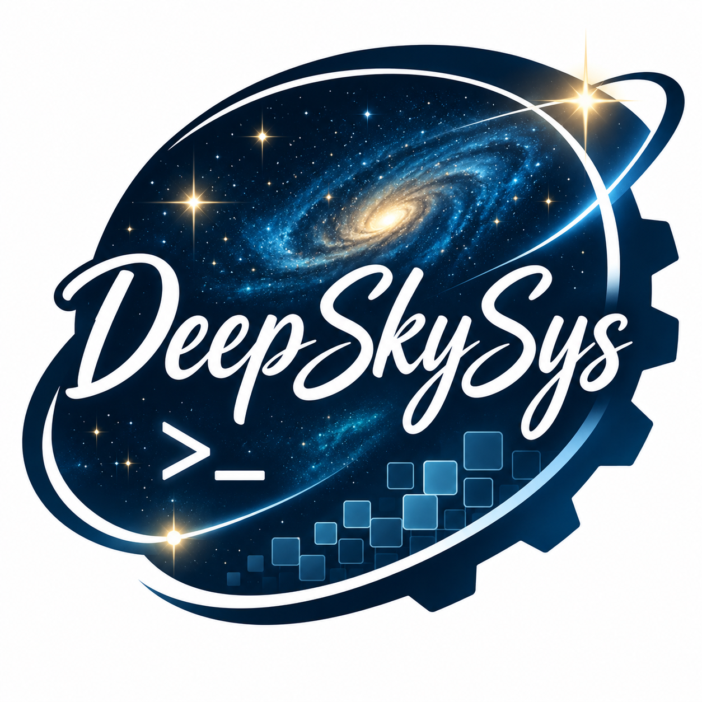

# DeepSkySys

The DSTCore library of the DeepSky Project: command-line option handling and other system utilities shared by the DeepSky libraries and tools.

## Building

Everything is built out of source: configuring in the source directory (`cmake .`) is refused.

```bash
git submodule update --init --recursive
cmake --preset default        # Release, in build/      (or: cmake -B build)
cmake --build build -j
ctest --preset default        # the tests run in build/, and what they write stays there
cmake --build build --target install
```

Other presets: `debug` (Debug, in `build-debug/`) and `asan` (Debug + AddressSanitizer, in `build-asan/`):
`cmake --preset asan && cmake --build --preset asan -j && ctest --preset asan`.

Options: `-DCMAKE_INSTALL_PREFIX=<path>` (default: `$DeepSkyROOT`, or the parent directory), `-DWITH_ASAN=ON`,
`-DBUILD_TESTS=OFF`. `-DWITH_DEBUG=ON` is deprecated: it means Debug + AddressSanitizer.

Former in-source builds left files in the sources (`CMakeCache.txt`, `Makefile`, `lib/`, ...); remove them once
with `cmake -P cmake/CleanInSourceBuild.cmake`.

## License

Licensed under the [PolyForm Noncommercial License 1.0.0](https://polyformproject.org/licenses/noncommercial/1.0.0/): free for noncommercial use. Commercial use requires a separate licence from the author. See [LICENSE.md](LICENSE.md).
Copyright (c) 2026 William Gillard.

*The logo has been generated by OpenAI's ChatGPT Image Generation tool (ImageGen).*
